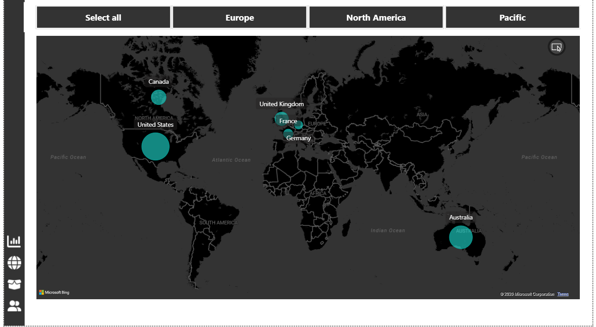
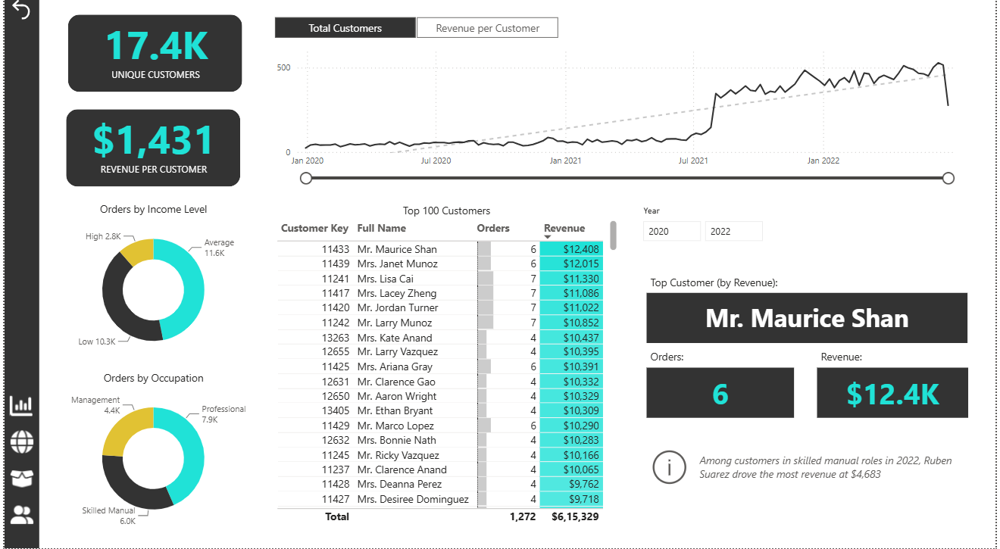

# Adventure Works Sales Analysis | Power BI Dashboard

**Microsoft Power BI | Power Query | DAX | Data Modeling | Business Intelligence**

An interactive Power BI dashboard built using the Adventure Works dataset to analyze sales performance, revenue, profit, returns, product performance, customer behavior, and geographical trends.

The project focuses on transforming raw data into meaningful business insights through interactive visualizations, dynamic metrics, KPI tracking, and advanced Power BI features.

---

## Table of Contents

- [About the Project](#about-the-project)
- [Business Objectives](#business-objectives)
- [Project Structure](#project-structure)
- [Project Workflow](#project-workflow)
- [Dashboard Overview](#dashboard-overview)
- [Advanced Power BI Features](#advanced-power-bi-features)
- [Key Features](#key-features)
- [Dashboard Screenshots](#dashboard-screenshots)
- [Tools and Technologies](#tools-and-technologies)
- [Skills Demonstrated](#skills-demonstrated)
- [Author](#author)

---

## About the Project

This project focuses on analyzing Adventure Works business data using Microsoft Power BI to evaluate sales performance and generate actionable business insights.

The dashboard provides an interactive view of key business metrics, including:

- Total Orders
- Revenue
- Profit
- Returns
- Return Percentage
- Product Performance
- Customer Performance
- Geographical Sales Distribution
- Monthly Sales Trends
- Target vs Actual Performance

The project demonstrates an end-to-end Power BI development workflow, including data cleaning, transformation, data modeling, DAX calculations, time intelligence, and interactive dashboard development.

---

## Business Objectives

The primary objectives of this project are:

- Analyze overall sales and revenue performance.
- Monitor profit and return trends.
- Identify top-performing products and customers.
- Understand customer purchasing behavior.
- Analyze geographical sales performance.
- Compare actual performance against business targets.
- Track monthly and historical business trends.
- Provide interactive business reporting for better decision-making.

---

## Project Structure

```text
Adventure-Works-Power-BI-Analysis/
│
├── ScreenShots/
│   ├── Exce Dashboard.png
│   ├── Map.png
│   ├── Product Details.png
│   ├── Category tooltip.png
│   └── Customer.png
│
├── Dataset/
│   └── Adventure Works Dataset
│
├── Power BI/
│   └── Adventure Works Dashboard.pbix
│
└── README.md
```

---

## Project Workflow

### 1. Data Preparation

- Imported the Adventure Works dataset into Power BI.
- Reviewed the dataset structure and available columns.
- Identified relevant tables and relationships.
- Prepared data for further analysis.

### 2. Data Cleaning and Transformation

Used Power Query to:

- Clean and transform raw data.
- Handle data types.
- Prepare tables for analysis.
- Organize data for efficient reporting.

### 3. Data Modeling

- Created relationships between relevant tables.
- Organized the data model.
- Established relationships to support cross-table analysis.
- Prepared the model for DAX calculations.

### 4. DAX Measures

Created DAX measures to calculate important business metrics such as:

- Orders
- Revenue
- Profit
- Returns
- Return Percentage
- Revenue per Customer
- Target Performance

### 5. Time Intelligence

Implemented time-based analysis to understand:

- Monthly performance trends.
- Historical sales patterns.
- Revenue and profit trends over time.

### 6. Dashboard Development

Developed interactive dashboard pages using KPI cards, charts, maps, slicers, tooltips, bookmarks, and navigation features.

---

## Dashboard Overview

The Power BI dashboard contains multiple analytical views to provide insights into different business areas.

### 1. Executive Dashboard

Provides a consolidated overview of business performance, including:

- Revenue and profit analysis.
- Total orders and returns.
- Monthly performance trends.
- Product and customer insights.
- Key performance indicators.

### 2. Map Analysis

Provides geographical analysis of business performance through:

- Regional sales distribution.
- Customer performance across locations.
- Geographical sales trends.

### 3. Product Details

Focuses on product-level performance through:

- Product orders.
- Revenue and profit analysis.
- Product target comparison.
- Price adjustment analysis.
- Product performance evaluation.

### 4. Category Tooltip

Displays additional category-level insights through a customized tooltip when users interact with category-level visuals.

### 5. Customer Details

Provides customer-level analysis, including:

- Customer information.
- Revenue per customer.
- Total orders.
- Income level.
- Occupation.
- Top customer analysis.

---

## Advanced Power BI Features

### 1. Category Tooltip

Created a custom **Category Tooltip** to display additional insights when users interact with category-level visuals.

### 2. Dynamic Metric Selection

Users can dynamically switch between key business metrics:

- Orders
- Revenue
- Profit
- Returns
- Return %

### 3. Interactive Map

Implemented an interactive map to analyze geographical sales and customer performance across different regions.

### 4. Target Analysis

Analyzed product performance against business targets for:

- Orders
- Revenue
- Profit

### 5. Bookmarks and Navigation

Used **Bookmarks and Page Navigation** to connect dashboard pages and provide a smooth interactive user experience.

---

## Key Features

- Interactive KPI cards.
- Sales, revenue, and profit analysis.
- Return rate analysis.
- Product and customer analysis.
- Geographic sales analysis.
- Monthly trend analysis.
- Top product and customer analysis.
- Orders, Revenue, and Profit vs Target.
- Dynamic metric selection.
- Interactive map visualization.
- Custom category tooltip.
- Bookmark-based navigation.
- Cross-page navigation.
- Interactive filters and slicers.

---

## Dashboard Screenshots

### 1. Executive Dashboard


Provides a consolidated view of **revenue, profit, orders, returns, products, and monthly trends**.

---

### 2. Map Analysis



Provides **geographical analysis** of sales and customer performance across different regions.

---

### 3. Product Details


Provides detailed **product performance, orders, revenue, profit, targets, and price adjustment analysis**.

---

### 4. Category Tooltip


Displays additional **category-level insights** through a customized tooltip.

---

### 5. Customer Details



Provides **customer-level analysis**, including customers, revenue per customer, orders, income level, occupation, and top customers.

---

## Tools and Technologies

- Microsoft Power BI
- Power Query
- DAX
- Data Modeling
- Time Intelligence
- Data Visualization
- Interactive Maps
- Bookmarks
- Custom Tooltips
- Dynamic Metrics

---

## Skills Demonstrated

- Power BI Dashboard Development
- Power Query and Data Transformation
- DAX and Measure Creation
- Data Modeling
- Time Intelligence
- KPI Development
- Interactive Data Visualization
- Sales and Revenue Analysis
- Profit and Return Analysis
- Product Performance Analysis
- Customer Analysis
- Geographic Analysis
- Interactive Map Visualization
- Dynamic Metric Selection
- Target vs Actual Analysis
- Bookmarks and Page Navigation
- Custom Tooltips
- Interactive Filters and Slicers
- Business Intelligence and Reporting

---

## Author

**Pritam Mohanta**

Data Analytics | Excel | Power BI | Python

---

**Adventure Works Sales Analysis | Power BI Dashboard**

Business Intelligence | Data Visualization | Interactive Reporting
